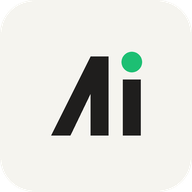

<div align="center">



# AdvisorPPC for Claude

**Work on your own ad accounts in the Claude apps, Cowork and Claude Code.**

Audit Google Ads campaigns, report across Google Analytics 4 and Search Console,
inspect Tag Manager, and review YouTube performance, all through one hosted
connector. No API keys in config. No local server to run.

[Website](https://advisorppc.com) · [Documentation](https://advisorppc.com/docs) · [Install](#install) · [Data](#data) · [Plans](#plans) · [Security](SECURITY.md) · [Support](SUPPORT.md)

[](LICENSE)
[](https://advisorppc.com/docs)
[](CHANGELOG.md)

</div>

---

## Overview

AdvisorPPC connects Claude to the accounts a performance marketer actually
works in: in the Claude apps (web, desktop and mobile), in Cowork and in Claude
Code. Once connected, Claude can pull live data, run structured audits, and, on
paid plans, change budgets and campaigns after you confirm each change, all
within what your plan permits.

This repository is the official distribution point for the plugin. It contains
the plugin manifest, the marketplace definition, the bundled skills, and their
test cases. The
connector itself runs as a hosted service at `mcp.advisorppc.com`, operated by
Advisor Media.

## Capabilities

| Area | What Claude can do |
| --- | --- |
| **Google Ads** | Account and campaign audits, wasted-spend analysis, search-term review, recommendations, change history; budget and campaign management on paid plans |
| **Google Analytics 4** | Traffic and conversion reporting, cross-channel performance context |
| **Search Console** | Query and page performance, indexing insight for organic-vs-paid analysis |
| **Tag Manager** | Container and tag setup inspection |
| **YouTube** | Channel and video performance review |

## What's in the box

- **Remote MCP server** (`advisorppc`): the hosted connector at
  `https://mcp.advisorppc.com/claude`. Authentication is browser OAuth on first
  use; credentials never live in your config files.
- **Skills** that teach Claude proven, repeatable workflows:
  - `google-ads-audit`: structured account and campaign audits covering baseline,
    wasted spend, search terms, recommendations, change history.
  - `ppc-reporting`: cross-platform performance reports over Ads, Analytics,
    Search Console, and YouTube, as prose or as a shareable dashboard page.
  - `getting-connected`: first-run setup, plans and billing, applying changes, troubleshooting.
  - `first-run`: on "get me started", gives the connect step for the app you
    are in, proves the connection with one real read and shows a first result
    from your account.
  - `no-ads-account`: with no Google Ads account, starts from Search Console
    or Google Analytics 4 with one small report, and a weekly check-in you can
    ask for.

## Example prompts

- "Get me started."
- "Audit my Google Ads account and find wasted spend from the last 30 days."
- "How did my ads do last month compared with the month before?"
- "Show me my top Search Console queries for the last 28 days."
- "Build my PPC dashboard for last month."
- "What plan am I on?"

## Install

### In the Claude apps and Cowork

Open **Customize**, then **Plugins**, find AdvisorPPC under **Discover** and add
it. Then open the plugin's **Connectors** tab, connect AdvisorPPC and sign in.
On Team and Enterprise plans, an Owner of the Claude organization adds the
connector first, and members then connect with their own account.

### In Claude Code

From the terminal:

```
claude plugin marketplace add advisorppc-org/advisorppc-plugin
claude plugin install advisorppc@advisorppc
```

Or interactively inside Claude Code:

```
/plugin marketplace add advisorppc-org/advisorppc-plugin
/plugin install advisorppc@advisorppc
```

## First run

1. Install the plugin. In Claude Code, start a new session.
2. Connect the connector: in Claude Code run `/mcp`, where the `advisorppc`
   server appears; in the Claude apps and Cowork use the plugin's
   **Connectors** tab. Connecting opens OAuth sign-in in your browser.
3. After consent, connect your ad accounts in the
   [dashboard](https://mcp.advisorppc.com/dashboard). Sign in to the ad platform
   with an identity that has access to the account.
4. Ask Claude to "get me started": it checks the connection with one real
   read and shows a first result from your account. No Google Ads account?
   It starts from Search Console or Google Analytics 4 instead.

For a headless or remote machine, use an interactive terminal and follow the
[headless login steps](skills/getting-connected/SKILL.md#headless-or-remote-machine),
including pasting the localhost redirect URL back into the login prompt or
forwarding the callback port.

## Plans

| Plan | Includes |
| --- | --- |
| **Free** | Read-only tools for periodic audits and reports, no card required |
| **Paid** | Write tools (budget and campaign management), each change only after your yes |

Ask Claude "what plan am I on?" to see your plan, what it includes and whether
calls are available now; the connector's `plan_tool` shows the live terms. To upgrade, ask Claude:
it shows your current plan, asks which plan you want (the plans are listed at
[mcp.advisorppc.com/pricing](https://mcp.advisorppc.com/pricing)), and then
hands over a secure checkout link for the plan you name. Ask about billing or
invoices for a link to the billing page; ask to cancel and Claude explains first,
then gives the cancel link once you confirm.

## Data

The plugin itself stores nothing and runs nothing on your computer: it holds
instructions for Claude and the address of the hosted connector. When you ask
for something, Claude calls the connector's tools at `mcp.advisorppc.com` with
the inputs the request needs, such as an account ID, a date range, a site
address or a property ID. The connector then reads the matching data from the
Google accounts you linked, with your own sign-in, and returns it to Claude.
On paid plans, Claude asks for your yes before each change it sends. How the
connector handles data is set out in the
[privacy policy](https://advisorppc.com/privacy).

## Security

- All product code runs server-side in the hosted connector; this repository
  contains only manifests, skills, test cases and documentation, with no
  executable server code and no secrets.
- Authentication is OAuth 2.1 in your own browser. The plugin never asks for,
  stores, or transmits API keys or passwords through configuration files.
- Every write operation is plan-enforced server-side.

To report a vulnerability, see [SECURITY.md](SECURITY.md).

## Troubleshooting

Opening `https://mcp.advisorppc.com/claude` directly in a browser returns
**401, and this is expected**: it is an MCP endpoint, not a web page. For anything
else, see the `getting-connected` skill bundled with this plugin, the
[docs](https://advisorppc.com/docs), or [SUPPORT.md](SUPPORT.md).

## License

The contents of this repository (manifests, skills, test cases, and documentation) are
released under the [MIT License](LICENSE). The AdvisorPPC hosted service, its
server code, name, and logo remain the property of Advisor Media.

---

<div align="center">
<sub>© 2026 Advisor Media · <a href="https://advisorppc.com">advisorppc.com</a></sub>
</div>
